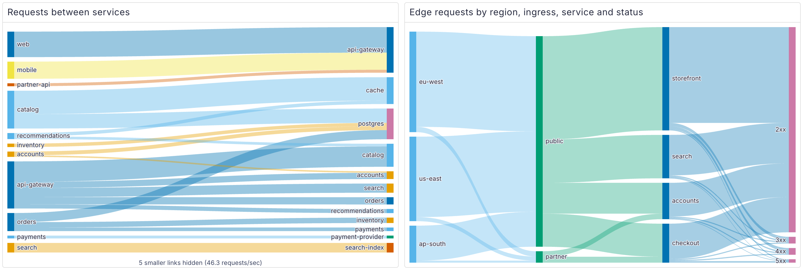
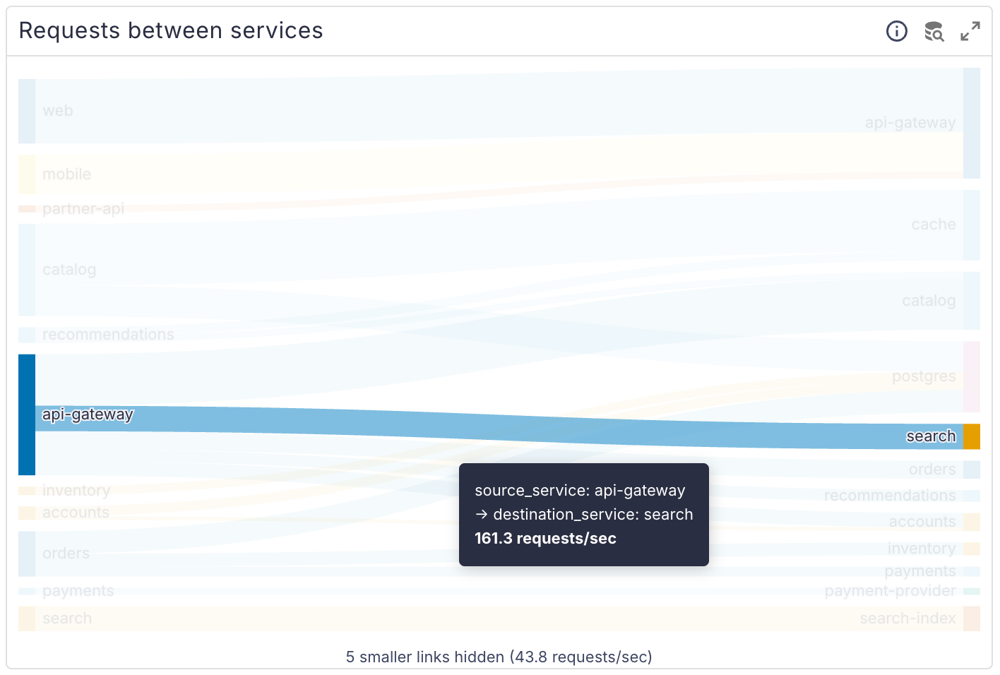
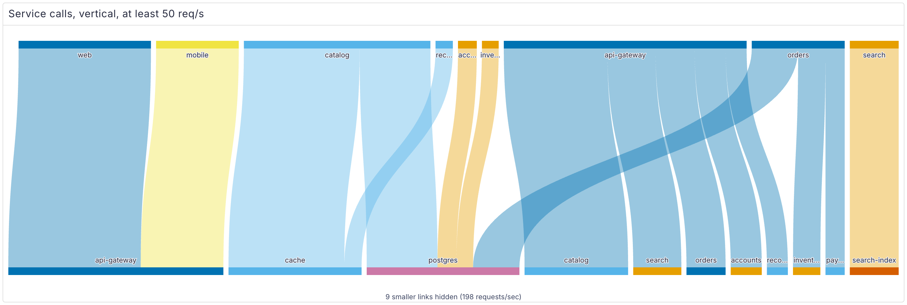

# perses-plugin-sankey

A [Perses](https://perses.dev) panel plugin, `SankeyChart`, that draws a Sankey flow diagram from a
time-series query. Each column is a label; the width of a link is the value flowing between two label
values. Typical uses:

- traffic between Kubernetes namespaces, from Cilium Hubble flow metrics
- a cost breakdown, cluster → namespace → workload
- request routing, for example ingress → service → backend

<picture>
  <source media="(prefers-color-scheme: dark)" srcset="docs/images/overview-dark.png">
  
</picture>

```promql
sum by (source_namespace, destination_namespace) (rate(hubble_flows_processed_total[5m]))
```

## Supported versions

| Plugin | Perses | Status |
| --- | --- | --- |
| 0.1.x | v0.55.x | Tested with v0.55.1 |

The plugin is built against `@perses-dev/*` 0.54 and `percli` v0.54.0. Other Perses minor versions may
work but are not tested; see [Why ECharts](#why-echarts) for the part most likely to break.

## What it does

- Each series is reduced to one number with a Perses calculation (`last`, `sum`, `mean`, ...).
- `levels` is an ordered list of label names, one column each. A series with the labels
  `cluster="a", namespace="shop", workload="api"` and `levels: [cluster, namespace, workload]` adds its
  value to the link `a → shop` and to the link `shop → api`. Series that share a link are summed, so
  the query does not have to aggregate exactly to the levels.
- A name can appear in several columns. Each column has its own nodes, so `A → B` and `B → A` are two
  links between two columns, never a cycle (ECharts rejects cycles in a Sankey). Traffic from a
  namespace to itself is a link from that name in the left column to the same name in the right one.
- `minValue` hides links below a value and `maxLinks` keeps only the largest links. A note under the
  chart says how many links were hidden and their total.
- A series without one of the level labels is not drawn, and the note says how many there were and
  which labels were missing. A label that is present but empty is shown as `(none)`. Negative values
  cannot be drawn in a Sankey; they are counted in the note too.
- Nodes are colored from the Perses chart palette: by node (`colorBy: source`; the same name gets the
  same color in every column and across refreshes, and each link takes its source node's color) or
  by column (`colorBy: level`).
- Hovering a node or link highlights everything connected to it. Tooltips show the column label, the
  name and the formatted value.

  <picture>
    <source media="(prefers-color-scheme: dark)" srcset="docs/images/hover-dark.png">
    
  </picture>
- Horizontal (left to right) or vertical (top to bottom) layout. In the vertical layout each label
  is cut to the width of its node, with an ellipsis, so neighboring labels do not overlap; the
  tooltip has the full name. Light and dark themes.

  <picture>
    <source media="(prefers-color-scheme: dark)" srcset="docs/images/vertical-dark.png">
    
  </picture>
- Without data the panel shows Perses' usual "No data" message.

### Examples

Traffic between namespaces, from Hubble flow metrics. The `flow` metric carries the
`source_namespace` and `destination_namespace` labels when it is enabled with
`labelsContext=source_namespace,destination_namespace` in the Hubble metrics config:

```promql
sum by (source_namespace, destination_namespace) (
  rate(hubble_flows_processed_total{verdict="FORWARDED"}[5m])
)
```

```yaml
levels: [source_namespace, destination_namespace]
format: { unit: decimal, decimalPlaces: 1 }
maxLinks: 40
```

Use `verdict="DROPPED"` to see dropped flows instead.

A multi-level cost breakdown, for example from an exporter that reports cost per container (the
metric name depends on your cost tool):

```promql
sum by (cluster, namespace, workload) (
  sum_over_time(container_cost_hourly[$__range])
)
```

```yaml
calculation: last
levels: [cluster, namespace, workload]
format: { unit: decimal, decimalPlaces: 2 }
minValue: 1
colorBy: level
```

The cluster column then splits into namespaces, and each namespace into its workloads.

### Spec

```yaml
plugin:
  kind: SankeyChart
  spec:
    calculation: last          # required: any Perses calculation
    levels:                    # label names, one column each, at least two
      - source
      - destination
    format: { unit: decimal }
    orientation: horizontal    # horizontal | vertical
    nodeAlign: justify         # justify | left | right
    minValue: 0                # hide links below this value
    maxLinks: 50               # keep only the largest N links; omit for all
    colorBy: source            # source | level
    linkOpacity: 0.4           # 0 to 1
```

All fields except `calculation` are optional. The values above are the defaults, except `maxLinks`,
which has no limit when it is omitted (new panels start with 50).

`nodeAlign` matters when a node has links on one side only, for example when `maxLinks` hid its
outgoing links: `justify` moves nodes without outgoing links to the last column, `left` keeps every
node as far left as its links allow, `right` as far right.

The CUE schema is in `schemas/panels/sankey-chart/`. A complete panel in a dashboard:

```yaml
panels:
  namespaceTraffic:
    kind: Panel
    spec:
      display: { name: Traffic between namespaces }
      plugin:
        kind: SankeyChart
        spec:
          calculation: last
          levels: [source_namespace, destination_namespace]
          format: { unit: decimal, decimalPlaces: 1 }
          maxLinks: 40
      queries:
        - kind: TimeSeriesQuery
          spec:
            plugin:
              kind: PrometheusTimeSeriesQuery
              spec:
                query: sum by (source_namespace, destination_namespace) (rate(hubble_flows_processed_total[5m]))
```

## Why ECharts

Perses already ships ECharts 5.5 and shares one copy with every plugin through module federation.
ECharts has a `sankey` series with layout, adjacency highlighting and tooltips, so the plugin adds no
charting library and has no runtime dependencies of its own.

The chart is drawn with `init` from the shared `echarts` module (see `SankeyCanvas.tsx`), not with
Perses' `EChart` component. That component uses Perses' own trimmed `echarts/core` build, which does
not register the `sankey` series. This means the plugin depends on Perses continuing to share the full
`echarts` package. Re-test it on every Perses upgrade.

## Try it locally

`dev/` runs Perses with the plugin, a Prometheus, and made-up request rates between services
(service to service, and edge traffic by region, ingress, service and status class) to draw. The
screenshots above come from it. It needs `podman compose` or `docker compose`.

```bash
npm ci && npm run build && percli plugin build
cp Sankey-*.tar.gz dev/archive/
podman compose -f dev/compose.yaml up -d    # PERSES_PORT=18080 to move it off 8080
```

Open <http://localhost:8080/projects/demo/dashboards/sankey>. Data appears after Prometheus' first
scrape, within a minute. `podman compose -f dev/compose.yaml down` removes it again.

## Build

You need Node 22 or later, [`percli`](https://github.com/perses/perses/releases/tag/v0.54.0) v0.54.0
and [`cue`](https://cuelang.org) on `PATH` (v0.17.1 tested). `percli` uses `cue` to vendor the Perses
CUE dependencies into the archive.

```bash
npm ci
npm run lint && npm run type-check
npm run build                 # module-federation bundle in dist/
percli plugin build           # validates the schema, writes Sankey-0.1.0.tar.gz
```

`npm run dev` serves the plugin for `percli plugin start` against a running Perses. See
[CONTRIBUTING.md](CONTRIBUTING.md) for more.

## Install into Perses

Perses extracts every `*.tar.gz` in `plugin.archive_paths` into `plugin.path` at startup. Setting
`archive_paths` replaces the default, so keep the directory of bundled plugins in the list. Pick one
of the three options below and restart Perses.

### Option A: release archive

Download `Sankey-<version>.tar.gz` from the
[GitHub releases](https://github.com/astrona-io/perses-plugin-sankey/releases), put it in a directory
Perses can read, and add that directory to the config:

```bash
curl -fLO https://github.com/astrona-io/perses-plugin-sankey/releases/download/v0.1.0/Sankey-0.1.0.tar.gz
```

```yaml
plugin:
  archive_paths:
    - /etc/perses/plugins-archive        # plugins bundled with Perses
    - /etc/perses/plugins-archive-extra  # put Sankey-0.1.0.tar.gz here
```

### Option B: Kubernetes image volume

The `Containerfile` packages the archive as a plugin-only OCI image (`FROM scratch`, the archive at the
image root). Every release publishes it as `ghcr.io/astrona-io/perses-plugin-sankey:v<version>` for
linux/amd64 and linux/arm64, so you can use that image directly. To build and push it to your own
registry instead:

```bash
percli plugin build
podman build -t ghcr.io/<owner>/perses-plugin-sankey:<version> .
podman push ghcr.io/<owner>/perses-plugin-sankey:<version>
```

Then mount it into the Perses pod as an
[image volume](https://kubernetes.io/docs/concepts/storage/volumes/#image) and add the mount path to
`archive_paths` as in option A. Image volumes need a cluster and container runtime that support them
(the `ImageVolume` feature; check your Kubernetes version and feature gates).

```yaml
volumes:
  - name: sankey-plugin
    image:
      reference: ghcr.io/<owner>/perses-plugin-sankey:<version>
      pullPolicy: IfNotPresent
containers:
  - name: perses
    volumeMounts:
      - name: sankey-plugin
        mountPath: /etc/perses/plugins-archive-extra
        readOnly: true
```

If the registry is private, add an `imagePullSecrets` entry to the pod as for any other image. To
install several plugins this way, mount each image at its own path and list every path in
`archive_paths`.

### Option C: custom Perses image

Copy the archive into the directory of bundled plugins. No config change is needed, because that
directory is in the default `archive_paths`:

```dockerfile
FROM persesdev/perses:v0.55.1
COPY Sankey-0.1.0.tar.gz /etc/perses/plugins-archive/
```

## Licences and credits

The plugin is Apache-2.0 (`LICENSE`). Third-party material and its notices are listed in `NOTICE`.

| What | Licence | Where |
| --- | --- | --- |
| This plugin | Apache-2.0 | `LICENSE` |
| Perses shared CUE (`cue.mod/pkg`, vendored into the archive) | Apache-2.0 | archive only |
